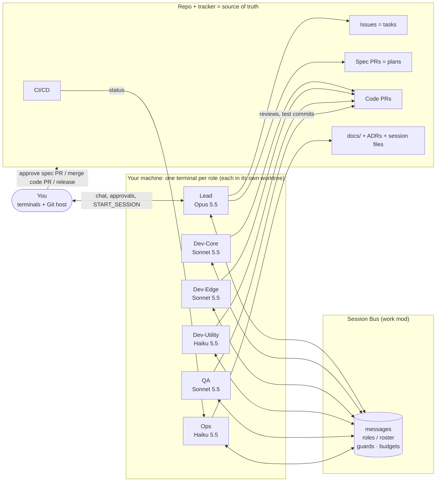

# Multi-Session Claude SDLC: Design (work setup, Session Bus)

**Status:** Draft v1 (work copy of `DESIGN.md`) · **Runtime:** Claude Code in a terminal, one terminal per role · **Shared state:** the work repo + its issue tracker / Git host
**Messaging:** **Session Bus**, the work setup's existing session messaging mod (the DevBus alternative)
**Human gates:** you approve every plan, every merge and every release
**Mode:** lean. Each request goes to one session (§2A). The full pipeline is only for features that need a spec (§5).

This is the work-setup version of [`DESIGN.md`](DESIGN.md). The team, models, routing, budgets,
session files and cost model are the same. Three things differ:

1. **Messaging uses Session Bus**, the session bus mod you already run at work, instead of DevBus.
   DevBus is not installed: the two would hook the same messaging events and conflict.
2. **Sessions run in terminals.** You start each role's terminal yourself (`claude --model …`).
   No session can start another, so the Lead *asks you* to start a role when work needs one.
3. **Names are placeholders** until mapped. Every assumed path, label, tool and command is listed in
   Appendix A with a **Your setup** column. Map them once, in one PR, before the pilot.

Where this document says **Session Bus does X**, that is a capability the design relies on. §4
lists each one as a requirement (R1–R9), with a fallback if Session Bus doesn't do it yet.

---

## 1. Design goals

| Goal | How it is met |
|---|---|
| **Token efficiency** | Each request goes to one session, not the whole team (§2A). Measured baseline: 464k tokens per request on all-Opus; target ≤ 0.9× (§5.4). Messages carry *pointers* (issue #, PR #, SHA, file path), never pasted content. Session Bus handles routine traffic (acks, heartbeats) without waking the model (R3). Each role gets the cheapest model that does the job well. A terminal waiting for a message uses no tokens. |
| **Quality** | Opus plans and makes the architecture calls. Every PR gets a separate test-and-review pass. Escalation path: Haiku → Sonnet → Opus. |
| **Human control** | Three hard gates (plan approval, merge and release). Agents never merge or push to the protected branch; Session Bus guards (R5) and branch protection block it. |
| **Traceability** | Every task is an issue, every plan is a spec PR, every change is a PR, every decision is an ADR. Bus messages always cite those IDs. |
| **Resilience** | Sessions are stateless apart from what is in the repo, the tracker and the session files (§2B), so any terminal can be closed and restarted from its handoff file. |

---

## 2. Team topology: 3 standing sessions + 3 lane-based dev sessions

Five responsibilities (architect, developer, tester, scribe, CI/CD) are packed into
**three standing sessions** (Lead, QA, Ops) plus **three dev sessions, one per lane**:

| # | Session | Roles | Model | Why this model |
|---|---|---|---|---|
| 1 | **Lead** | Architect / design lead, orchestrator, your single point of contact | **Opus 5.5** (`claude-opus-5-5`) | Few but high-impact calls: decomposition, interfaces, trade-offs, design review. |
| 2 | **Dev lanes** (Core, Edge, Utility, §2.1) | Developer / coder | **Sonnet 5.5** (`claude-sonnet-5-5`) for Core and Edge, **Haiku 5.5** (`claude-haiku-5-5`) for Utility | The highest-volume token users. Sonnet codes at near-Opus quality for less; Haiku takes small tickets. All use Haiku subagents for codebase search. |
| 3 | **QA** | Tester and code reviewer | **Sonnet 5.5** | Testing and review need real reasoning; a separate context keeps the review independent. |
| 4 | **Ops** | CI/CD and scribe (docs, changelog, release notes) | **Haiku 5.5** | Mostly mechanical: CI, logs, lint fixes, changelog, docs. Escalates anything non-trivial. |

Model names may differ in your organization: check with `/model` and record them in Appendix A.3.

**Terminals.** Start with **Lead + one dev lane + QA**. Open the others when the Lead asks
(`START_SESSION` request, §4.2). A terminal that's idle costs nothing, so leaving one open is
fine; close dev lane terminals when their lane has no work, to keep contexts fresh.

### 2.1 Dev lanes

| Session | Owns | Typical work | Model |
|---|---|---|---|
| **Dev-Core** (backend) | API routes, business logic, data models, database migrations, auth | Endpoints, services, storage | Sonnet 5.5 |
| **Dev-Edge** (interface and integrations) | Frontend or templates, CLI interfaces, clients for outside APIs, config files | UI pages, CLIs, third-party API calls, wiring parts together | Sonnet 5.5 |
| **Dev-Utility** (small and mechanical) | Issues labelled `size:S` in any area, standalone scripts | Small fixes, dependency bumps, renames, small refactors, automation scripts | Haiku 5.5, hands off after 1 failed attempt |

**Why lanes:** fewer merge conflicts (each lane owns its folders), lower cost (small tickets on
Haiku), steadier context (a lane prompt that never changes is cached).

**How the Lead assigns work:**
1. `size:S` → **Dev-Utility**, whatever the area.
2. Otherwise by the folders the change touches: backend → **Dev-Core**; UI, CLI or integrations → **Dev-Edge**.
3. A change that crosses lanes is split in the spec into one issue per lane, with the shared
   interface (API contract or schema) defined first. Core builds its side first; Edge builds against it.
4. Lane folder ownership is declared in each spec under "Lane ownership" and in the lane repo
   maps. Session Bus warns when a dev edits outside its lane (R5), if it supports that.

**Hand-off from Utility.** If Dev-Utility can't finish a `size:S` issue in 1 attempt, it sends
`ESCALATE` to the Lead, which relabels it `size:M` and reassigns it to Core or Edge.

### Escalation path (model routing)

```
Haiku (Ops / Dev-Utility) ──can't fix in 1 attempt──▶ Sonnet (Dev-Core / Dev-Edge) ──2 failed attempts / design question──▶ Opus (Lead) ──needs product decision──▶ You
```

- Ops fixes lint, format, lockfile and flaky-retry issues itself. A real test failure goes to the PR's dev.
- A dev escalates to the Lead after 2 failed attempts at one problem, or on any interface or schema question.
- **Opus deep review** (the Lead, after QA approves) is required for PRs that are large
  (`size:L`, or more than 400 changed lines) **and** either a **major infrastructure change**
  (CI/CD, deployment or infrastructure-as-code, Dockerfiles, database schema or migrations,
  new services, major-version dependency upgrades) or a **major feature** (`feature:major`: a
  new user-facing capability, an epic spanning lanes, or a new public API). Such PRs are
  labelled `review:opus`. All other PRs get QA's Sonnet review only.

---

## 2A. Request routing: one request, one session (lean mode)

**Each request goes to the one session that owns that type of work.** The full pipeline
(§5) is used only for features that need a spec.

### Routing table

| Request type | Label | Goes to | Model |
|---|---|---|---|
| Design / architecture / spec | `type:design` | Lead | Opus 5.5 |
| Development, medium or large | `type:dev` + `size:M`/`size:L` + `lane:core`/`lane:edge` | Dev-Core or Dev-Edge | Sonnet 5.5 |
| Development, small | `type:dev` + `size:S` | Dev-Utility (batched) | Haiku 5.5 |
| Testing | `type:test` | QA | Sonnet 5.5 |
| Audit, routine | `type:audit` | QA | Sonnet 5.5 |
| Audit, major | `type:audit` + `review:opus` | Lead | Opus 5.5 |
| Documentation | `type:docs` | Ops | Haiku 5.5 |

A request with no `type:*` label goes to the Lead for labelling only (≤ 10k tokens).

**Who does the routing:**
- **Preferred (R6):** Session Bus, in the Lead's terminal, reads labelled issues and sends each
  `TASK` with fixed rules, so no model turn is spent on routing. DevBus's router
  (`tools/devbus/hooks/lib/policy.ts`: `route()`, `batch()`) is a reference you can port.
- **Fallback:** the Lead model applies the table above. Keep it cheap: the Lead reads only issue
  titles and labels, never bodies, and sends one `TASK` per issue (or one per `size:S` batch).
  Expect a few thousand Opus tokens per routed request.
- **Simplest:** you send a request straight to the role's terminal yourself. Fine for a pilot.

### Lean-mode rules

| # | Rule | Effect on tokens | Enforced by |
|---|---|---|---|
| 1 | **Routing by rules**, not by the Lead's reasoning (table above) | Opus not used on non-design requests | Session Bus (R6) or Lead prompt |
| 2 | **Small dev requests stay in one session.** Dev-Utility does the work end to end; review is a Haiku diff check plus CI. No QA session, no Lead. | Small tasks at Haiku prices | Role prompts |
| 3 | **Batching.** Dev-Utility takes up to 10 related `size:S` requests per area at once | ~20–40% fewer tokens on small tasks | Session Bus (R6) or Lead prompt |
| 4 | **QA works from the diff and test plan**, ~30k context per review; wider context only through Haiku subagents | QA overhead ~10–15% of a dev task | QA prompt |
| 5 | **Ops is mostly scripts.** Changelog generated from PR titles; CI checks are scripts. Haiku only for CI failures and real docs edits | Near-zero Ops tokens on most tasks | Ops prompt |
| 6 | **Token budget per request:** `size:S` 300k, `size:M` 550k, `size:L` 1.4M, design 500k, docs 300k. Warn at 80%; at 100% stop and send `BUDGET`/`ESCALATE` | Caps runaway sessions | Session Bus (R4) or role prompts |
| 7 | **Small contexts.** `/compact` at ~60k tokens; read the lane repo map instead of exploring | Each turn re-reads less | Role prompts |
| 8 | **Fresh context per unrelated request.** Run `/clear` (or restart the terminal) between unrelated requests, except batched `size:S` work; the handoff file carries what matters | Avoids long, expensive contexts | Role prompts, you |

**Trade-off:** small dev requests have no separate QA session. CI, the Haiku diff check and
your merge approval still apply. Adding QA back costs about 0.1–0.15× of a request's tokens per small task.

---

## 2B. Session files: handoff, memory and lessons

Each session writes its **own** handoff and memory (it already holds the context, so this
is nearly free). The shared lessons file has one curator.

| File (assumed name, map in A.1) | Who writes it | When | Who tidies it | Size cap |
|---|---|---|---|---|
| `.sessions/<role>/handoff.md` | The session itself (overwrite) | End of each task, before `/compact` or `/clear`, on `BUDGET`/`ESCALATE`, before closing the terminal | Nobody needed | ~40 lines |
| `.sessions/<role>/memory.md` | The session itself (append) | When it learns a lasting fact about its lane | Ops trims past the cap | ~60 lines |
| `docs/lessons.md` (shared) | Any session appends one line (Edit, never rewrite) | After an escalation, a failed attempt, a review asking for changes, or a CI failure | Ops curates weekly; the Lead approves process changes | ~100 lines |

**Reading rules:** on start and on each new task, a session reads its own `handoff.md` and
`memory.md` plus the **Active** section of `docs/lessons.md`, and nothing of other roles'
unless a handoff points to it.

**Restarting a terminal** is cheap because of the handoff file: start `claude --model …`
again (or `claude --continue` to resume the last conversation in that folder), and the session
picks up from `handoff.md`.

**Formats** (templates in `docs/sdlc/templates/`): handoff = task and status · tokens used/budget
· done (commits, PRs) · next · open questions · files touched. Memory = *Conventions*,
*Gotchas*, *Commands*, each line dated or with a PR reference. Lessons =
`- YYYY-MM-DD [role] <lesson> (ref #n)` under **Active** / **Archive**.

**Version control:** committed with the task's PR. Each role owns its folder, so conflicts are rare.

**Ownership rules** (Session Bus guard R5, or role prompts if it has no file guards): every role
writes only `.sessions/<own role>/`; Ops may also trim others' `memory.md`; everyone may Edit
`docs/lessons.md`; only Ops rewrites it whole.

**Shared working tree.** If several terminals run in the **same** repo folder they share one
checkout, so branch switches collide. Give each terminal its own worktree
(`git worktree add ../<repo>-<role> <branch>`) and start that role's `claude` there.

---

## 3. Architecture



### 3.1 Communication layers

| Layer | Mechanism | Used for |
|---|---|---|
| Session start and stop | **You** open a terminal (`claude --model <id>`), assign its role through Session Bus, and paste its setup prompt; close it when done | The Lead requests a role with `START_SESSION`; you start it |
| Messaging | **Session Bus** | All coordination between sessions |
| Durable state | Repo, issues, PRs, labels, `docs/`, session files | Everything that must outlive a terminal |
| CI and review events | Ops checks PR and CI status through the Git host's CLI or MCP tools (e.g. `gh pr checks`) when it gets a task, or on a timer if your setup allows (`/loop`) | Ops reacts to CI; devs react to review comments |
| Scheduling | A `/loop` or scheduled check in the Lead or Ops terminal if available; otherwise you trigger it | Daily stand-up digest, weekly lessons curation, stale-task sweeps |

---

## 4. Session Bus: what this design needs from it

Session Bus is your work setup's existing session messaging mod. This design doesn't replace
it; it relies on the capabilities below. For each one, check whether Session Bus already does
it, and record the answer (and the tool or command name) in Appendix A.4.

DevBus (`tools/devbus/` in the original repo) implements all of them and can serve as reference
code to port: `hooks/lib/envelope.ts` (message format, secret scrubbing) and
`hooks/lib/policy.ts` (routing, batching, budgets, guards) are plain functions with tests.

| # | Requirement | Why it matters | If Session Bus doesn't do it |
|---|---|---|---|
| **R1** | **Address sessions by role** (`lead`, `dev-core`, …), with a roster of role → session | Senders don't spend turns working out who to send to | Name each terminal's session after its role, and keep a roster in `.sessions/roster.md` that the Lead maintains |
| **R2** | **Structured, short messages:** type, from, to, task #, PR #, sha, reply-to id, plus a summary of ≤ ~600 chars; refuse pasted code or logs | Pointers instead of payloads; small contexts on the receiver | Role prompts require the format in §4.2; the receiver ignores pasted content |
| **R3** | **Routine traffic never reaches the model:** acks, heartbeats, roster updates, status updates and duplicates are handled by the mod | The biggest token saving: no model turn per routine message | Drop heartbeats; send `STATUS` only at milestones; don't acknowledge messages |
| **R4** | **Token budget per request:** count tokens from each model response, warn at 80%, block tool use at 100% until the session reports `BUDGET` | Caps runaway sessions | Role prompts: check `/cost`-style usage at milestones, stop and report at the budget. Weaker, but works |
| **R5** | **Guards:** no merge, no force-push, no push to the protected branch; tags/releases only by Ops after your approval; per-role write scopes; session-file ownership (§2B); lane warnings | Your gates can't be bypassed by a model | Branch protection on the Git host + role-prompt rules + Claude Code permission rules (`deny` for merge/force-push commands) |
| **R6** | **Routing by rules:** read labelled issues and send `TASK`s by the §2A table, batching `size:S` | Opus not spent on routing | The Lead routes from titles and labels (§2A fallback), or you send requests directly |
| **R7** | **Usage logging:** tokens per finished request, with request type, role and model; a report against the 464k baseline | Needed for the pilot (§5.5) | Each session writes tokens used into its handoff at task end; collect them, or use your org's usage dashboard |
| **R8** | **Person-only release approval:** a command only you can issue (not a model) that records "release vX.Y.Z approved" for Ops | Gate 3 can't be forged by a session | You tell Ops directly in its terminal; Ops is told never to accept release approval over the bus |
| **R9** | **Secret scrubbing** on outgoing messages | Keys don't leak between sessions | Role prompts forbid pasting secrets; refer to sensitive files by path only |

### 4.1 Roles and roster

- **Assigning roles:** when you start a terminal, assign its role through Session Bus (record the
  command in A.4) and paste the role's setup prompt (§7.1).
- **Roster:** Session Bus's own roster if it has one (R1). Otherwise the Lead keeps
  `.sessions/roster.md`: `role | session name/id | terminal | started | current task`.
- **Starting a role on demand:** the Lead can't open terminals. It sends you
  `START_SESSION role=<role> model=<model> reason=#<issue>`; you open the terminal, assign
  the role and paste the prompt.

### 4.2 Message content

Use Session Bus's own format. Whatever its syntax, every message should carry these fields
(map the actual syntax in A.4):

```
type=<TYPE> from=<role> to=<role|*> task=#<issue> pr=#<pr|-> sha=<short|-> reply=<id|->
<summary ≤ ~600 chars: what happened / what you need; pointers only, no pasted code or logs>
```

| Type | Sender → Receiver | Meaning | Model turn? |
|---|---|---|---|
| `TASK` | Lead (or router) → Dev/QA/Ops | Do issue #N (kind, budget, spec path, branch) | Yes |
| `ACK` | receiver → sender | Received / started | No (R3) |
| `STATUS` | worker → Lead | Milestone only | No (R3), shown to you |
| `BLOCKED` | any → Lead | Needs a decision; options A/B + recommendation | Yes |
| `REVIEW_REQ` | Dev → QA | PR #M ready (CI green, self-reviewed) | Yes |
| `REVIEW_RESULT` | QA → Dev, cc Lead | `approve` or `changes` (details in PR comments) | Yes |
| `CI_FAIL` | Ops → Dev | Job, failing test, log line range | Yes |
| `ESCALATE` | any → next tier | Can't solve (§2 path) | Yes |
| `APPROVAL_REQ` | Lead → You | Spec, code or release PR ready for your gate | — |
| `START_SESSION` | Lead → You | Please open a terminal for `<role>` on `<model>` | — |
| `DONE` | worker → Lead | Task finished, PR merged; include tokens used | Yes (Lead) |
| `HEARTBEAT` | any → Lead | Alive + current task (optional) | No (R3) |
| `BUDGET` | session/mod → Lead | Request hit its token budget | Yes |

---

## 5. Lifecycle: one feature, end to end (medium and large features with a spec)

```mermaid
sequenceDiagram
    autonumber
    actor You
    participant L as Lead (Opus)
    participant D as Dev lane (Core/Edge: Sonnet, Utility: Haiku)
    participant Q as QA (Sonnet)
    participant O as Ops (Haiku)
    participant GH as Repo / tracker

    You->>L: Feature request (in the Lead terminal or an issue)
    L->>GH: Create epic + task issues
    L->>GH: Open spec PR docs/specs/N-*.md (+ ADR if needed)
    L-->>You: APPROVAL_REQ: plan (spec PR #S)
    You->>GH: Approve & merge spec PR  ⟵ GATE 1
    L-->>You: START_SESSION dev-core (if not running)
    You->>D: Open terminal, assign role, paste setup prompt
    L->>D: TASK #N via Session Bus (spec path, branch, budget)
    D-->>L: ACK (Session Bus)
    D->>GH: Commits on feat/N, open draft PR #M
    O->>GH: Check CI on PR #M
    O->>O: Fix lint/format itself
    O->>D: CI_FAIL (real failures only)
    D->>Q: REVIEW_REQ PR #M
    Q->>GH: Add tests, PR review
    Q->>D: REVIEW_RESULT changes / approve
    Q-->>L: cc REVIEW_RESULT
    O->>GH: Changelog + docs commit on PR #M
    L->>GH: Opus deep review (only for review:opus PRs)
    L-->>You: APPROVAL_REQ: merge PR #M
    You->>GH: Merge  ⟵ GATE 2
    D->>D: Write handoff.md; DONE to Lead
    Note over L,O: When a release is due
    L->>O: TASK release vX.Y.Z
    O->>GH: Open release PR (version bump, CHANGELOG, notes)
    L-->>You: APPROVAL_REQ: release PR
    You->>GH: Merge release PR, then approve the tag (R8)  ⟵ GATE 3
    O->>GH: Tag vX.Y.Z + publish release
    You->>D: Close the dev lane terminal if its lane is idle
```

### 5.1 Phases and owners

| Phase | Owner | Output | Gate |
|---|---|---|---|
| 1. Intake | Lead | Epic + task issues with acceptance criteria | — |
| 2. Design | Lead | Spec PR `docs/specs/<n>-<slug>.md` (interfaces, data model, test plan, task split, lane ownership), optional ADR | **You approve and merge the spec PR** |
| 3. Build | Dev(s) | Feature branch + draft PR referencing the issue | — |
| 4. CI | Ops | Green checks; trivial fixes by Ops | — |
| 5. Test & review | QA | Test commits + PR review | QA approval required |
| 6. Docs | Ops | `CHANGELOG.md`, README/docs on the same PR | — |
| 7. Merge | **You** | Merged PR | **You merge** |
| 8. Release | Lead decides when; Ops prepares | Release PR `release/vX.Y.Z`; after merge and your approval, tag + release | **You merge the release PR and approve the tag** |

### 5.2 How you approve

- **Plan:** merge the spec PR (comment on it to request changes; the Lead revises).
- **Merge:** you click Merge. Branch protection and Session Bus guards (R5) stop agents.
- **Release:** merge the release PR, then approve the tag with Session Bus's person-only command
  (R8), or tell Ops directly in its own terminal if Session Bus has none.
- You can always type to any terminal directly ("pause", "re-plan #14", "stop and write your handoff").

### 5.3 Token-saving rules

1. **Pointers, not payloads** in every message (R2).
2. **Routine traffic never reaches a model** (R3).
3. **Milestone-only status**: PR opened, ready for review, done.
4. **Fresh contexts:** `/clear` between unrelated requests; `/compact` at ~60k; close idle dev lane terminals.
5. **Stable prompts = cache hits:** paste the setup prompt once at start; role files never change mid-session.
6. **Cheap exploration:** Haiku `Explore` subagents for search; read lane repo maps first.
7. **Lead reads diffs sparingly:** specs and `review:opus` PRs only.
8. **CI logs:** job + failing test + line range, never full logs.

### 5.4 Cost model (calibrated to measured usage)

> **Status: estimate.** Same model as `DESIGN.md` §5.4; the pilot (§5.5) replaces the multipliers with measurements.

**Baseline (measured):** 2,500 requests in 7 days used 1.16B tokens, all on Opus: **464k tokens per request**.

**Assumptions:** request mix design 15%, development 40% (40% of those `size:S`), testing 20%,
audit 10% (30% major), docs 15%. Overhead +5% for Session Bus hand-offs and escalations
(more, perhaps +7–10%, if routing falls back to the Lead model). 85% cached input, ~2% output.
Prices per 1M tokens (input / output / cached input): Opus 5.5 $4 / $20 / $0.20; Sonnet 5.5
$2 / $10 / $0.20; Haiku 5.5 $0.10 / $0.50 / ~$0.01 (assumed). Your organization's pricing or
plan limits may differ.

| Request type | Session / model | Tokens vs. baseline |
|---|---|---|
| Design | Lead / Opus | ~0.9× |
| Development, M/L | Dev-Core, Dev-Edge / Sonnet | ~0.9× |
| Development, S | Dev-Utility / Haiku | ~0.9× (~0.6–0.7× batched) |
| Testing | QA / Sonnet | ~0.8× |
| Audit, routine | QA / Sonnet | ~0.9× |
| Audit, major | Lead / Opus | ~0.9× |
| Docs | Ops / Haiku | ~0.7× |
| Hand-offs + escalations | mixed | +5% |

**Weekly projection at 4,000 requests:**

| | Current (all Opus) | This model (routing only) | + full lean mode |
|---|---|---|---|
| Tokens per week | 1.86B | **~1.67B (−10%)** | ~1.4–1.5B (−20–25%) |
| Opus / Sonnet / Haiku share | 100 / 0 / 0% | ~18 / 51 / 28% | ~20 / 50 / 27% |
| Est. cost per week | ~$2,400 | **~$1,060 (−55%)** | ~$900–950 (−60%) |

Rule of thumb: weekly tokens ≈ requests × 464k × 0.90 (routing only), or × ~0.78 (full lean mode).

### 5.5 Pilot

1. Run ~100 requests in the usual mix (15/40/20/10/15).
2. Record tokens per request, type, role and model: Session Bus usage logging (R7), or the
   token line each session writes in its handoff at task end.
3. Compare each type against 464k; update the multipliers here and the budgets in `sdlc.config.json`.
4. Move any request type whose cheaper model escalates often up a model tier.

---

## 6. Repo and tracker conventions (assumed names; map in Appendix A)

| Item | Convention |
|---|---|
| Labels | `type:design|dev|test|audit|docs` · `size:S|M|L` · `lane:core|edge|utility` · `area:<name>` · `state:planned|in-progress|review|blocked` · `routed:<role>` · `review:opus` `feature:major` `infra:major` · `release` · `needs-approval` |
| Branches | `spec/<n>-<slug>` (Lead), `feat/<n>-<slug>` / `fix/<n>-<slug>` (devs), `release/vX.Y.Z` |
| PR body | `Closes #n`, spec link, test plan, size and any `review:opus` / `infra:major` / `feature:major` labels |
| Branch protection | Protected branch: 1 human approval, required CI, no force push |
| Docs | `docs/specs/`, `docs/adr/`, `CHANGELOG.md` (Keep a Changelog), `docs/sdlc/repo-map/` |
| Roster | Session Bus roster, or `.sessions/roster.md` (Lead) |

---

## 7. Bootstrapping (terminals)

> **Runnable version:** [`SETUP-work.md`](SETUP-work.md) has the copy commands, the terminal start-up,
> the Lead and worker prompts, and setup tasks S0–S10 that the Lead dispatches. The steps below are the summary.

1. **Map names.** Fill in Appendix A for the work repo and Session Bus; apply the renames in one
   PR across the kit files (role prompts, `protocol.md`, `sdlc.config.json`, templates).
2. **Copy the kit** into the work repo: `docs/sdlc/roles/*.md`, `docs/sdlc/protocol.md`,
   `docs/sdlc/sdlc.config.json`, `docs/sdlc/templates/`, `docs/lessons.md`, `.sessions/<role>/`,
   and this document. Write lane repo maps for the work repo (`docs/sdlc/repo-map/`, ≤ ~60
   lines each). Don't copy `tools/devbus/`, `.claude-plugin/` or the DevBus settings.
3. **Check Session Bus** against R1–R9 and note the fallbacks you'll use (Appendix A.4).
4. **Protect the main branch** (1 human approval + CI) and **create the labels** (§6).
5. **Add Claude Code permission rules** as a backstop for R5, e.g. deny merge and force-push
   commands in the repo's `.claude/settings.json`.
6. **Start the Lead:** in its own worktree, `claude --model claude-opus-5-5`, assign the role
   `lead` through Session Bus, paste the Lead setup prompt (§7.1).
7. **Start QA and one dev lane** the same way (Sonnet), and others when the Lead sends `START_SESSION`.
8. **Give work:** labelled issues (`state:planned` + `type:*` + `size:*`, and `lane:*` for medium and large
   dev work), routed by Session Bus (R6), by the Lead, or sent by you to a terminal.
9. **Pilot** (§5.5) after ~100 requests.

### 7.1 Setup prompts

Paste into each terminal after assigning its role. Replace `<SEND_TOOL>` and the paths with the
mapped names from Appendix A.

**Lead** (`claude --model claude-opus-5-5`):

```
You are the LEAD session of a multi-session Claude dev team for this repository: architect, design lead and orchestrator, and my single point of contact. Sessions run in separate terminals and talk over Session Bus.

1. Read docs/sdlc/roles/lead.md and follow it as your role instructions for this entire session. Where it mentions DevBus or bus_send, use Session Bus and <SEND_TOOL> instead.
2. Read docs/sdlc/protocol.md and docs/sdlc/DESIGN-work.md sections 2A, 2B, 4 and 5 only.
3. Read .sessions/lead/handoff.md, .sessions/lead/memory.md and the Active section of docs/lessons.md.
4. You cannot start sessions. When work needs a role that isn't running, send me START_SESSION role=<role> model=<model> reason=#<issue>.
5. Route requests by the table in section 2A from issue titles and labels only, unless Session Bus routes them.

Rules: you design and decide, you don't write production code. Never merge, push to the protected branch or bypass my approvals. Ask me only for product decisions or approvals, with options A/B and a recommendation.

Reply with a 5-line status: role, sessions running, open planned issues, anything blocked, what you need from me.
```

**Workers** (Dev-Core and Dev-Edge and QA on Sonnet, Dev-Utility and Ops on Haiku). Fill in `<role>`,
its role file and its lane map:

```
You are the <ROLE> session of a multi-session Claude dev team for this repository. Sessions run in separate terminals and talk over Session Bus.

1. Read docs/sdlc/roles/<role>.md and follow it as your role instructions for this entire session. Where it mentions DevBus or bus_send, use Session Bus and <SEND_TOOL> instead.
2. Read docs/sdlc/protocol.md and your lane map docs/sdlc/repo-map/<lane>.md (QA and Ops: only when a task touches a lane).
3. Read .sessions/<role>/handoff.md, .sessions/<role>/memory.md and the Active section of docs/lessons.md.
4. Message other sessions only through <SEND_TOOL>, using the fields in DESIGN-work.md section 4.2: pointers only, summary at most ~600 chars.
5. Stay within your token budget per request (section 2A rule 6); at the budget, write your handoff, send BUDGET to the Lead and stop.

Then wait for a TASK. Reply only: "<role> ready".
```

---

## 8. Failure handling

| Failure | Detection | Response |
|---|---|---|
| Terminal closed or crashed | Session Bus roster or missing heartbeats; you notice | Restart: `claude --model …` (or `claude --continue`) in the same worktree, assign the role, paste the prompt; it resumes from `handoff.md` |
| Agents disagree (QA vs Dev) | 2 rounds of `changes` on one PR | Escalate to the Lead, which decides or asks you |
| CI red repeatedly | Ops can't fix in 1 attempt | `CI_FAIL` to the dev; after 2 dev attempts, `ESCALATE` to the Lead |
| Budget exceeded | Session Bus (R4) or the session's own check | `BUDGET` to the Lead, which splits the task or moves it to a fresh session |
| Two terminals on one checkout | Branch switches collide | One git worktree per terminal (§2B) |
| Lead lost | You notice | Start a new Lead; it rebuilds state from issues, the roster and `.sessions/lead/handoff.md` |

---

## 9. Open decisions (for the work setup)

1. **Session Bus capabilities:** which of R1–R9 it already has; which fallbacks to use; whether to port DevBus pieces (routing R6, budgets R4, guards R5) into it.
2. **Model names** available in your organization (A.3).
3. **Routing owner** for the pilot: Session Bus (R6), the Lead model, or you sending requests directly.
4. **Tracker:** GitHub issues/labels assumed; map them if the work setup uses another tracker (A.2, A.3).

---

Files in this design (work setup):

- `docs/sdlc/DESIGN-work.md`: this document
- `docs/sdlc/prompts.md`: ready-to-paste setup prompts for the Lead, Dev-Core, Ops and QA terminals
- `docs/sdlc/SETUP-work.md`: runnable setup (copy kit, start terminals, prompts, tasks S0–S10 for the Lead to dispatch)
- `docs/sdlc/sdlc.config.json`: roles, models, routing, budgets, session files (ignore its `devbus` section, or map it to Session Bus settings)
- `docs/sdlc/roles/*.md`: role prompts (they say DevBus/`bus_send`; the setup prompts tell sessions to substitute Session Bus, or rename them via Appendix A)
- `docs/sdlc/protocol.md`: message fields and types (read with §4.2)
- `docs/sdlc/templates/`, `docs/lessons.md`, `.sessions/<role>/`: session files (§2B)
- `docs/sdlc/repo-map/`: write new maps for the work repo
- Reference only (don't install alongside Session Bus): `tools/devbus/`

---

## Appendix A. Name and path mapping (work setup)

Every name below is an assumption. Fill in **Your setup** from the work repo and Session Bus,
then apply the renames in one PR and search for each old name (`grep -rn "<old>" docs/`) to
confirm nothing is left. Write `same` where the assumed name already fits.

### A.1 Session files (§2B)

| Item | Assumed name / path | Details | Defined in / change in | Your setup |
|---|---|---|---|---|
| Handoff file | `.sessions/<role>/handoff.md` | One per role, overwritten at task end, before compact/clear, on budget or escalation, before closing. ≤ ~40 lines | §2B; config `sessionFiles.handoff`; role prompts; Session Bus guard config (R5) | |
| Memory file | `.sessions/<role>/memory.md` | One per role, appended, lasting lane facts. Ops trims past ~60 lines | §2B; config `sessionFiles.memory`; role prompts | |
| Lessons file | `docs/lessons.md` | Shared. Append one line with Edit; only Ops rewrites. Sessions read only **Active**. ≤ ~100 lines | §2B; config `sessionFiles.lessons`; role prompts | |
| Session folder root | `.sessions/` | One folder per role | §2B | |
| Roster file (fallback) | `.sessions/roster.md` | Only if Session Bus has no roster (R1) | §4.1; `lead.md` | |
| Per-role folder names | role IDs (A.3) | | §2B | |
| File-name case | lowercase | | everywhere above | |
| Handoff / memory / lessons formats | see §2B | | `docs/sdlc/templates/*.md` | |
| Templates folder | `docs/sdlc/templates/` | | §2B; role prompts | |
| Version control | committed with each task's PR | | §2B; config `sessionFiles.committed` | |
| Size caps | 40 / 60 / 100 lines | | §2B; config | |

### A.2 Project documents, branches and tracker

| Item | Assumed name / path | Details | Defined in / change in | Your setup |
|---|---|---|---|---|
| Issue tracker | GitHub issues + labels | Tasks, routing labels | §6, §2A | |
| Git host / CLI | GitHub, `gh` | PR and CI status for Ops | §3.1; `ops.md` | |
| Specs | `docs/specs/<n>-<slug>.md` | Spec PR = gate 1; must include **Lane ownership** | §5; `lead.md` | |
| ADRs | `docs/adr/NNNN-<slug>.md` | By the Lead | §5; `lead.md` | |
| Changelog | `CHANGELOG.md` (Keep a Changelog) | Generated by script; Ops | §5.1; `ops.md` | |
| Lane repo maps | `docs/sdlc/repo-map/{core,edge,utility}.md` | ≤ ~60 lines; write for the work repo | §2A rule 7; dev prompts | |
| Spec branch | `spec/<n>-<slug>` | | §6; `lead.md` | |
| Feature / fix branch | `feat/<n>-<slug>`, `fix/<n>-<slug>` | | §6; dev prompts | |
| Release branch / tag | `release/vX.Y.Z` / `vX.Y.Z` | Tag after release PR merge + your approval (R8) | §5.1; `ops.md` | |
| Protected branch | `main` | No direct or force push | §6; R5 | |
| Worktree folders | `../<repo>-<role>` | One per terminal | §2B | |

### A.3 Roles, models and labels

| Item | Assumed name | Details | Defined in / change in | Your setup |
|---|---|---|---|---|
| Role IDs | `lead`, `dev-core`, `dev-edge`, `dev-utility`, `qa`, `ops` | Addressing, folders, guards | §2; config `roles`; Session Bus role names | |
| Models | Lead `claude-opus-5-5`; Dev-Core, Dev-Edge, QA `claude-sonnet-5-5`; Dev-Utility, Ops `claude-haiku-5-5` | Check with `/model` | config `roles.*.model`; §7 | |
| Type labels | `type:design`, `type:dev`, `type:test`, `type:audit`, `type:docs` | Routing | §2A, §6 | |
| Size labels | `size:S`, `size:M`, `size:L` | Routing, budgets | §2A, §6; config `budgets` | |
| Lane labels | `lane:core`, `lane:edge`, `lane:utility` | Medium/large dev work | §2.1, §6 | |
| Batching label | `area:<name>` | Groups `size:S` | §6 | |
| State labels | `state:planned`, `state:in-progress`, `state:review`, `state:blocked` | | §6 | |
| Router label | `routed:<role>` | Set by whoever routes | §6 | |
| Review / risk labels | `review:opus`, `feature:major`, `infra:major`, `release`, `needs-approval` | | §2, §6; `qa.md`, `lead.md` | |

### A.4 Session Bus (replaces DevBus names)

| Item | DevBus name in the kit files | Session Bus requirement | Your setup (name, or "fallback") |
|---|---|---|---|
| Send tool | `bus_send` (`mcp__devbus__bus_send`) | R1, R2 | |
| Board / roster view | `bus_board` | R1 | |
| Set role | `bus_set_role`, `/devbus-role <role>`, `DEVBUS_ROLE` | R1 | |
| Register a session for a role | `bus_roster_set`, `/devbus-roster <role> <id>` | R1 | |
| Session addressing | session id (`session_…`) via roster | R1 | |
| Message format | `[DEVBUS/1] id= type= from= to= task= pr= sha= reply=` + summary ≤ 600 chars | R2 | |
| Message types | `TASK ACK STATUS BLOCKED REVIEW_REQ REVIEW_RESULT CI_FAIL ESCALATE APPROVAL_REQ DONE HEARTBEAT BUDGET ROSTER` (+ `START_SESSION` here) | R2 | |
| Routine traffic handled by the mod | `ACK HEARTBEAT ROSTER STATUS`, duplicates | R3 | |
| Token budgets | per-request budgets, warn 80%, block at 100% | R4 | |
| Guards | no merge / force-push / protected-branch push; release tags; write scopes; session files; lane warnings | R5 | |
| Router | `bus_route`, `/devbus-route`, polls `state:planned` | R6 | |
| Usage report | `/devbus-usage`, `.devbus/usage.jsonl` | R7 | |
| Release approval (person only) | `/devbus-approve-release vX.Y.Z` | R8 | |
| Secret scrubbing | on outgoing messages | R9 | |
| Board UI / status line | `/devbus` pane, `devbus · role · #task · tokens/budget` | (nice to have) | |
| Config file | `docs/sdlc/sdlc.config.json` (`devbus` section) | — | |
