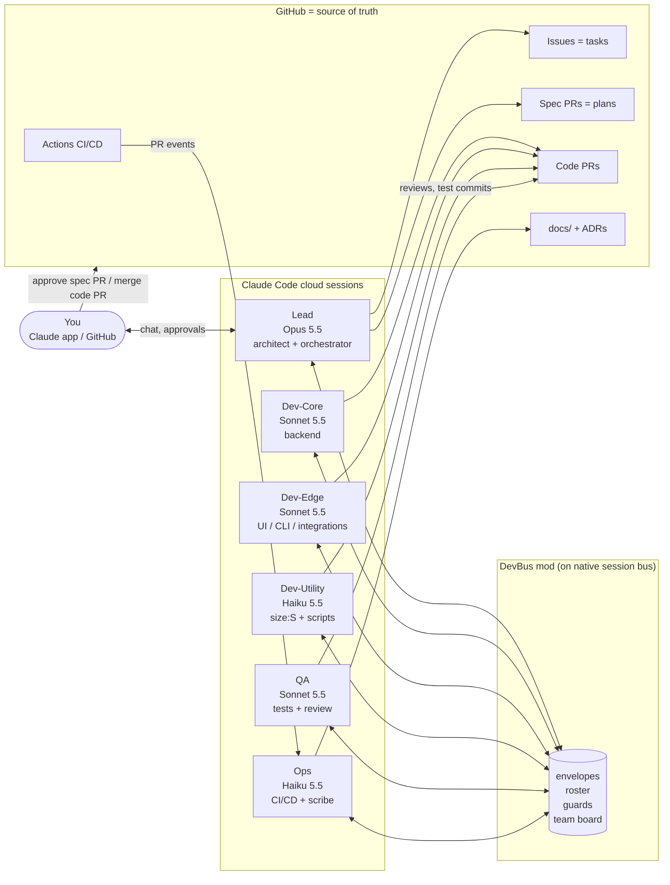
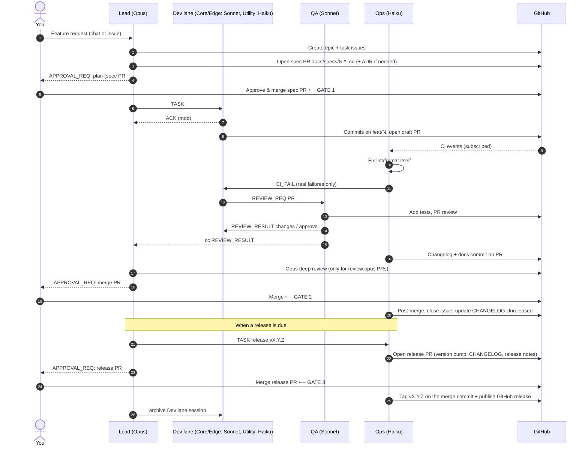

# Multi-Session Claude SDLC — Design

**Status:** Draft v1 · **Runtime:** Claude Code cloud sessions · **Shared state:** GitHub
**Human gates:** you approve every plan, every merge and every release
**Mode:** lean. Each request goes to one session (§2A). The full pipeline is only for features that need a spec (§5).

This document describes a software development lifecycle (SDLC) in which a small team
of Claude Code cloud sessions works together like a dev team. Each session has its own
role and model, and they coordinate through **DevBus**, a mod built on Claude's native
session bus. GitHub stays the single source of truth for every artifact.

> **Work setup:** for terminal-only sessions that use the work's existing **Session Bus** instead of
> DevBus, see [`DESIGN-work.md`](DESIGN-work.md).

---

## 1. Design goals

| Goal | How it is met |
|---|---|
| **Token efficiency** | Each request goes to one session, not the whole team (§2A). Measured baseline: 464k tokens per request on all-Opus; target ≤ 0.9× (§5.4). Messages carry *pointers* (issue #, PR #, SHA, file path), never pasted content. The mod handles acks and heartbeats without waking the model. Each role gets the cheapest model that does the job well. Short-lived worker sessions keep contexts small. |
| **Quality** | Opus plans and makes the architecture calls. Every PR gets a separate test-and-review pass. Escalation path: Haiku → Sonnet → Opus. |
| **Human control** | Three hard gates (plan approval, merge and release). Agents can never merge or push to `main`; the mod blocks those calls. |
| **Traceability** | Every task is a GitHub issue, every plan is a spec PR, every change is a PR, every decision is an ADR. Bus messages always cite those IDs. |
| **Resilience** | Sessions are stateless apart from what is in GitHub, so any session can be archived and recreated from the roster and the issue history. |

---

## 2. Team topology: 3 standing sessions + 3 lane-based dev sessions

You named five responsibilities: architect, developer, tester, scribe and CI/CD. They
are packed into **three standing sessions** (Lead, QA, Ops) plus **three dev sessions,
one per lane**, pairing roles that share context and cost profile:

| # | Session | Roles | Model | Why this model |
|---|---|---|---|---|
| 1 | **Lead** | Architect / design lead, orchestrator, your single point of contact | **Opus 5.5** (`claude-opus-5-5`) | Few but high-impact calls: decomposition, interfaces, trade-offs, design review. Mostly reads, writes little, so Opus pricing is spent where it matters. |
| 2 | **Dev lanes** (Core, Edge, Utility, see §2.1) | Developer / coder | **Sonnet 5.5** (`claude-sonnet-5-5`) for Core and Edge, **Haiku 5.5** for Utility | The highest-volume token users. Sonnet gives near-Opus coding quality at a fraction of the cost, and Haiku handles the small tickets. All use Haiku subagents for codebase search. |
| 3 | **QA** | Tester and code reviewer | **Sonnet 5.5** | Writing tests and reviewing code needs real reasoning. Uses a separate context from Dev, so its review is independent. |
| 4 | **Ops** | CI/CD and scribe (docs, changelog, release notes) | **Haiku 5.5** (`claude-haiku-5-5`) | Mostly mechanical work: watching CI, reading logs, applying lint/format fixes, writing changelogs and README updates. Escalates anything non-trivial. |

Why not five sessions? Pairing **scribe + CI/CD** works because both trigger on the
same event ("a PR changed") and both are low-reasoning. Pairing **tester + reviewer**
gives one independent "second pair of eyes" with fresh context. A separate scribe
session would mostly sit idle and re-read the same PRs, which wastes tokens.

### 2.1 Dev lanes

The three dev sessions each own a **lane**: a set of folders and a kind of work. Each
lane is started only when it has work and closed after its PR merges, so at most one
session runs per lane (`maxDevs: 3`).

| Session | Owns | Typical work | Model |
|---|---|---|---|
| **Dev-Core** (backend) | API routes, business logic, data models, database migrations, auth | Flask/FastAPI endpoints, services, storage | Sonnet 5.5 |
| **Dev-Edge** (interface and integrations) | Frontend or templates, CLI interfaces, clients for outside APIs, config files | UI pages, CLIs, third-party API calls, wiring parts together | Sonnet 5.5 |
| **Dev-Utility** (small and mechanical) | Issues labelled `size:S` in any area, standalone scripts | Small bug fixes, dependency bumps, renames and refactors, one-off automation scripts | Haiku 5.5, hands off after 1 failed attempt |

**Why lanes:**
- **Fewer merge conflicts.** Each lane owns its own folders, so parallel devs rarely touch the same files.
- **Lower cost.** Small tickets go to Haiku instead of Sonnet. QA still reviews every PR.
- **Steadier context.** A lane-specific prompt stays the same on every spawn, so it is cached.

**How the Lead assigns work:**
1. `size:S` → **Dev-Utility**, whatever the area.
2. Otherwise route by the folders the change touches: backend → **Dev-Core**; UI, CLI or integrations → **Dev-Edge**.
3. A change that crosses lanes is split in the spec into one issue per lane, with the shared
   interface (API contract or schema) defined first. Core builds its side first, then Edge
   builds against it.
4. Lane folder ownership for each project is declared in the spec, under "Lane ownership".
   The DevBus mod warns when a dev edits outside its lane.

**Hand-off from Utility.** If Dev-Utility can't finish a `size:S` issue in 1 attempt, it
sends `ESCALATE` to the Lead. The Lead relabels the issue (`size:M`) and reassigns it to Core or Edge.

### Escalation path (model routing)

```
Haiku (Ops / Dev-Utility) ──can't fix in 1 attempt──▶ Sonnet (Dev-Core / Dev-Edge) ──2 failed attempts / design question──▶ Opus (Lead) ──needs product decision──▶ You
```

- Ops fixes lint, format, lockfile and flaky-retry issues on its own. A real test failure
  goes to the PR's Dev.
- Dev escalates to the Lead after 2 failed attempts at one problem, or on any question
  about an interface or schema.
- **Opus deep review** (the Lead reviews, after QA approves) is required for PRs that are
  large (`size:L`, or more than 400 changed lines) **and** either a
  **major infrastructure change** (CI/CD workflows, deployment or infrastructure-as-code,
  Dockerfiles, database schema or migrations, new services, major-version dependency upgrades)
  or a **major feature** (issue labelled `feature:major`: a new user-facing capability, an epic
  spanning lanes, or a new public API). Such PRs are labelled `review:opus`.
  The Lead marks expected cases at spec time; QA applies the label when it sees a PR matches.
  All other PRs get QA's Sonnet review only.

---

## 2A. Request routing: one request, one session (lean mode)

Most requests are a single piece of work: a design, a coding task, a test, an audit or a
doc. **Each request goes to the one session that owns that type of work.** It is not sent
through the whole team. The full pipeline in §5 is used only for features that need a
spec (medium and large features).

### Routing table

The DevBus mod routes each request with fixed rules from its `type:*` and `size:*` labels
and the folders it touches. No model turn is spent on routing, and the Lead is not involved
unless the request is design work.

| Request type | Label | Goes to | Model |
|---|---|---|---|
| Design / architecture / spec | `type:design` | Lead | Opus 5.5 |
| Development, medium or large | `type:dev` + `size:M`/`size:L` | Dev-Core or Dev-Edge (by folders) | Sonnet 5.5 |
| Development, small | `type:dev` + `size:S` | Dev-Utility (batched) | Haiku 5.5 |
| Testing | `type:test` | QA | Sonnet 5.5 |
| Audit, routine | `type:audit` | QA | Sonnet 5.5 |
| Audit, major (large + major infra or major feature) | `type:audit` + `review:opus` | Lead | Opus 5.5 |
| Documentation | `type:docs` | Ops | Haiku 5.5 |

A request with no `type:*` label goes to the Lead once for labelling only, with a capped
turn (≤ 10k tokens). The Lead labels it and DevBus routes it.

### Lean-mode rules (enforced by the mod or the role prompts)

| # | Rule | Effect on tokens |
|---|---|---|
| 1 | **The mod routes requests**, not the Lead (table above). | Opus is not used on non-design requests |
| 2 | **Small dev requests stay in one session.** Dev-Utility does the work end to end. Review is a Haiku diff check plus CI. No QA session, no Lead. | Small tasks cost about the same tokens as today, at Haiku prices |
| 3 | **Batching.** Dev-Utility takes up to 10 related `size:S` requests in the same area in one session, so it learns the codebase once. | ~20–40% fewer tokens on small tasks |
| 4 | **QA works from the diff and test plan**, with a cap of ~30k context per review. It explores the wider codebase only through Haiku subagents. | QA overhead ~10–15% of a dev task |
| 5 | **Ops is mostly scripts.** The changelog is generated from PR titles and CI checks are plain scripts. Haiku runs only on a CI failure or a real docs edit. | Near-zero Ops tokens on most tasks |
| 6 | **Token budget per request**, enforced by the mod (`session.measure`): `size:S` 300k, `size:M` 550k, `size:L` 1.4M, design 500k. At 80% the session gets a warning. At 100% it stops and sends `BUDGET`/`ESCALATE` instead of looping. | Caps runaway sessions |
| 7 | **Small contexts.** Sessions compact at ~60k tokens. Each lane keeps a short repo map (`docs/sdlc/repo-map/<lane>.md`) so it doesn't have to explore. | Each turn re-reads less |
| 8 | **Fresh session per request type change.** A session never carries one request's context into an unrelated one, except batched `size:S` work. | Avoids long, expensive contexts |

**Trade-off:** small dev requests have no separate QA session. CI, the Haiku diff
check and your merge approval still apply. Keeping QA on every request adds about 0.1–0.15×
of a request's tokens for each small task.

---

## 2B. Session files: handoff, memory and lessons

Each session writes its **own** handoff and memory. It already holds the context, so a
few lines cost almost nothing. Sending that context to another session to write it down
would cost more tokens than writing it directly. The shared lessons file has one curator.

| File | Who writes it | When | Who tidies it | Size cap |
|---|---|---|---|---|
| `.sessions/<role>/handoff.md` | The session itself | End of each task, before `/compact`, on `BUDGET`/`ESCALATE`, and before the session ends | Overwritten each time; no tidying | ~40 lines |
| `.sessions/<role>/memory.md` | The session itself | When it learns a lasting fact about its lane: conventions, gotchas, commands that work | Ops trims it past the cap | ~60 lines |
| `docs/lessons.md` (shared) | Any session adds one line (Edit, never a full rewrite) | After an escalation, a failed attempt, a review asking for changes, or a CI failure | Ops removes duplicates and merges entries weekly; the Lead approves lessons that change process or role prompts | ~100 lines |

**Reading rules (token budget):**
- At startup, and when it takes a new task, a session reads its own `handoff.md` and `memory.md`, plus
  the **Active** section of `docs/lessons.md`. It doesn't read other roles' session files unless a
  handoff from that role points to one.
- Files stay short because every session reads them at startup and each later turn re-reads its context.
  Pointers (paths, PR numbers, commits) are used instead of copied content, as on the bus.

**Formats** (templates in `docs/sdlc/templates/`):
- `handoff.md`: task and status · done (with commits and PRs) · next steps · open questions · files touched · tokens used/budget.
- `memory.md`: bullet facts grouped as *Conventions*, *Gotchas*, *Commands*, each with a date or PR reference.
- `lessons.md`: `- YYYY-MM-DD [role] <lesson> (ref #issue/#pr)`, under **Active** (read by
  everyone) and **Archive** (kept, not read at startup). The Lead turns process lessons into changes to the role prompts.

**Where they live in git:** session files are committed with the task's PR, so the next
session, or a new terminal, sees them. Each role owns its own folder, so merge conflicts are
rare. `docs/lessons.md` takes only appended lines between Ops' weekly curation PRs.

**Enforced by DevBus:** every role may write `.sessions/<own role>/`. Ops may also trim
other roles' `memory.md`. Every role may `Edit` `docs/lessons.md`, but only Ops may rewrite it whole
(`Write`). Writes to another role's session folder are denied.

---

## 3. Architecture



### 3.1 Communication layers

| Layer | Mechanism | Used for |
|---|---|---|
| Session spawn and lifecycle | `create_session` (with `model`, `append_system_prompt`, `source_url`, `outcome_branch`), `archive_session` | The Lead creates and retires workers |
| Messaging | Native session bus: `send_message` / `$.session.send`, delivered as `session.receive` | All coordination between agents |
| DevBus mod | Hooks on `session.send`, `session.receive`, `tool.call`, plus registered tools, commands and a pane | Envelope format, routing by role, guardrails, token saving, team board |
| Durable state | GitHub issues, PRs, labels, `docs/` | Everything that must outlive a session |
| External events | `subscribe_pr_activity` (CI, reviews, comments) | Ops and Devs react to CI and review comments |
| Scheduling | `send_later` / scheduled tasks | Lead's daily stand-up digest, stale-task sweeps |

---

## 4. DevBus mod: design

DevBus is a Claude Code **mod** (hooks module plus manifest) installed in every session.
It does not replace the native bus. It wraps it, adding structure and enforcement.

### 4.1 What it hooks (as built: `tools/devbus/`)

**Status: built.** `claude plugin validate` passes and 29 tests pass (`claude plugin test tools/devbus`).
It has not run in live sessions yet; the pilot (§5.5) is its first real run. Code:
`hooks/lib/envelope.ts` (format), `hooks/lib/policy.ts` (routing, budgets, guards: pure
functions), `hooks/register.tsx` (hooks, tools, commands, pane).

| Hook / API | Behaviour |
|---|---|
| `session.start` | Loads `docs/sdlc/sdlc.config.json` (the `devbus` section plus budgets, models, prompts) and reads the role from state or `DEVBUS_ROLE`. Registers the model tools and commands, starts the heartbeat timer and (Lead only) the router timer, opens the board pane. |
| Model tools | `bus_send` (the only way to message: builds, validates and scrubs the envelope, resolves role → session from the roster; `isDeferred: false`), `bus_board`, `bus_set_role` (once), `bus_roster_set` (Lead), `bus_route` (Lead). |
| Delivery | `$.session.send({ to: { sessionId } })` on the native bus. If that's refused, it falls back to the remote-session server's `send_message`. |
| `session.send` | Refuses the model's raw SendMessage when it has no envelope ("use bus_send"). Scrubs secret-like values from every outgoing message. |
| `session.receive` | Parses envelopes and drops duplicate ids. **Consumes** `ACK`, `HEARTBEAT`, `ROSTER` and `STATUS`, so no model turn is spent on them. Auto-ACKs a `TASK` and starts its token count. Shortens everything else before the model reads it. The Lead's copy records `tokens=` from `DONE` messages for team-wide usage. |
| `turn.step` | Adds every response's usage (uncached + cache write + cache read + output) to the current request. At 80% of its budget it shows a toast. At 100% it sends `BUDGET` to the Lead and blocks further tool calls except the bus. |
| `tool.call` guards | Session files per §2B (own `.sessions/<role>/`; `docs/lessons.md` by Edit, whole rewrite by Ops only). For every role: blocks merge and auto-merge, `gh pr merge`, force-push and push to `main`/`master`. Tags and releases (`git tag`, `gh release create`, GitHub release tools) are allowed only for Ops and only after the person runs `/devbus-approve-release <tag>`. Session management is Lead-only. Per-role write scopes (Lead: specs, ADRs, sdlc docs; QA: test files; Ops: docs, changelog, `.github`, version files). Dev lanes get a warning (not a denial) for edits outside `devbus.lanePaths`. |
| Router (Lead) | Every `routerPollMinutes`, it lists open `state:planned` issues through the GitHub MCP server and routes them by label (§2A), batching `size:S` per `area:*` or lane. It spawns missing sessions with `create_session` on the configured model and role prompt when `autoSpawn` is on, sends `TASK` with `kind` and `budget`, and relabels issues `state:in-progress` + `routed:<role>`. Design and labelling tasks for the Lead itself arrive as a prompt. No model turn is spent on routing. |
| UI | **Board pane**: role, current task with tokens/budget, roster with last-seen and STALE flags, message feed. **Status line**: `devbus · role · #task · tokens/budget`. **Toasts** on `APPROVAL_REQ`, `BLOCKED`, `BUDGET` and lane warnings. |
| Commands | `/devbus`, `/devbus-role <role>`, `/devbus-roster <role> <session_id>`, `/devbus-approve-release vX.Y.Z` (accepted only from the person's own input, not the model), `/devbus-usage` (avg tokens per request kind vs. the 464k baseline), `/devbus-route`. |

**Roster distribution.** `$.store` is per container, so it is **not** shared across
cloud sessions. The Lead owns the roster (`role → sessionId`). It records entries with
`bus_roster_set` or automatically on spawn, and sends each session a `ROSTER` addressed to
that session's role. A session with no role adopts it from that message. A copy is
also kept in a pinned GitHub issue, "DevBus roster", which the Lead model maintains, so a
recreated Lead can recover it.

**Distribution of the mod.** The repo root holds `.claude-plugin/marketplace.json`
(marketplace `mycode-devbus`, plugin source `./tools/devbus`), and `.claude/settings.json`
enables `devbus@mycode-devbus` for every session that clones the repo. The marketplace is
read from the default branch, so automatic install starts once the mod is on `main`.
Manual install: `/plugin install devbus --marketplace ghazamu/mycode`.

**Lane repo maps.** `docs/sdlc/repo-map/{core,edge,utility}.md` are short per-lane maps.
Their folder globs are the same as `devbus.lanePaths` in the config.

### 4.2 Envelope format (DevBus v1)

One line of header, then at most 600 chars of summary. Pointers only.

```
[DEVBUS/1] id=<ulid> type=<TYPE> from=<role> to=<role|*> task=#<issue> pr=#<pr|-> sha=<short|-> reply=<id|->
<summary: what / what you need — no pasted code or logs>
```

| Type | Sender → Receiver | Meaning | Model turn? |
|---|---|---|---|
| `ROSTER` | Lead → * | Current role → session map | No (mod stores it) |
| `TASK` | Lead → Dev/QA/Ops | Do issue #N. Spec at `docs/specs/N-*.md`, branch `feat/N-slug` | Yes |
| `ACK` | any → sender | Received / started | No |
| `STATUS` | worker → Lead | Progress milestone | Batched (see 5.3) |
| `BLOCKED` | any → Lead | Needs a decision; summary gives options A/B | Yes |
| `REVIEW_REQ` | Dev → QA | PR #M ready for test and review | Yes |
| `REVIEW_RESULT` | QA → Dev, cc Lead | `approve` or `changes` (details in PR review comments) | Yes |
| `CI_FAIL` | Ops → Dev | CI failed on PR #M. Job and log line refs only | Yes |
| `ESCALATE` | any → next tier | Can't solve, see path in §2 | Yes |
| `APPROVAL_REQ` | Lead → You (via chat + PR) | Spec PR, code PR or release PR ready for your gate | — |
| `DONE` | worker → Lead | Task finished, PR merged | Yes (Lead) |
| `HEARTBEAT` | any → Lead | Alive + current task | No |
| `BUDGET` | mod → Lead | Session hit its token budget | Yes |

---

## 5. Lifecycle: one feature, end to end (medium and large features with a spec)



### 5.1 Phases and owners

| Phase | Owner | Output (in GitHub) | Gate |
|---|---|---|---|
| 1. Intake | Lead | Epic issue + task issues with acceptance criteria | — |
| 2. Design | Lead | Spec PR: `docs/specs/<n>-<slug>.md` (interfaces, data model, test plan, task split), optional `docs/adr/NNNN-*.md` | **You approve and merge the spec PR** |
| 3. Build | Dev(s) | Feature branch + draft PR referencing the issue | — |
| 4. CI | Ops | Green checks. Trivial fixes committed by Ops | — |
| 5. Test & review | QA | Test commits + PR review (approve or changes) | QA approval required |
| 6. Docs | Ops (scribe) | `CHANGELOG.md`, README/docs updates on the same PR | — |
| 7. Merge | **You** | Merged PR | **You merge** |
| 8. Release | Lead decides when; Ops prepares | Release PR `release/vX.Y.Z` (version bump, `CHANGELOG.md`, release notes). After merge: tag + GitHub release | **You approve and merge the release PR** |

### 5.2 How you approve

- **Plan approval = merging the spec PR.** It's reviewable, diffable and leaves an
  audit trail. Comment on the spec PR to request changes, and the Lead (subscribed to
  it) revises.
- **Merge approval = you clicking Merge** on the code PR. Agents are blocked from
  merging by the mod and by branch protection.
- **Release approval = merging the release PR, then `/devbus-approve-release vX.Y.Z`.** Ops tags
  and publishes only after both. The DevBus mod blocks tagging and release creation for a tag
  you haven't approved, and accepts that command only from your own input, not from a model.
- You can always talk to the Lead directly in the Claude app ("pause Dev-Edge", "re-plan #14").

### 5.3 Token-saving rules (enforced by the mod or role prompts)

1. **Pointers, not payloads.** Messages cite `#issue`, `#pr`, SHAs and file paths. The receiver pulls only what it needs from GitHub.
2. **Mod-handled traffic.** `ACK`, `HEARTBEAT`, `ROSTER` and duplicates are consumed by the mod and never reach the model.
3. **Batched status.** Workers send `STATUS` only at milestones (PR opened, ready for review, done), not per commit.
4. **Fresh contexts per task.** Dev lane sessions are created when their lane has work and archived after merge. Standing sessions `/compact` with "keep: roster, open tasks" between features.
5. **Stable prompts = cache hits.** Role prompts are passed once via `append_system_prompt` and never edited mid-session, so the prompt prefix stays cacheable.
6. **Cheap exploration.** Dev and QA use Haiku `Explore` subagents for codebase search and keep only the conclusions.
7. **Lead reads diffs sparingly.** It reviews specs and `review:opus` PRs only. QA covers the rest.
8. **CI logs.** Ops passes job name + failing test + log line range, never full logs.

### 5.4 Cost model (calibrated to measured usage)

> **Status: estimate.** Calibrated against the measured baseline below. The per-type
> multipliers are estimates until the pilot (§5.5) measures them.

**Baseline (measured):** 2,500 requests in 7 days used 1.16B tokens, all on Opus. That's
**464k tokens per request**. Each request was one task: design, development, testing,
auditing or documentation.

**Assumptions:**
- **Request mix:** design 15%, development 40% (40% of those `size:S`), testing 20%, audit 10% (30% of those major), docs 15%.
- **Overhead:** +5% for DevBus hand-offs and escalations from cheaper models.
- **Cost inputs:** 85% of input read from the prompt cache, ~2% of tokens are output.
- **Prices** (per 1M tokens, input / output / cached input): Opus 5.5 $4 / $20 / $0.20; Sonnet 5.5 $2 / $10 / $0.20; Haiku 5.5 $0.10 / $0.50 / ~$0.01 (assumed).

| Request type | Session / model | Tokens vs. baseline |
|---|---|---|
| Design | Lead / Opus | ~0.9× |
| Development, M/L | Dev-Core, Dev-Edge / Sonnet | ~0.9× |
| Development, S | Dev-Utility / Haiku | ~0.9× (~0.6–0.7× with batching) |
| Testing | QA / Sonnet | ~0.8× |
| Audit, routine | QA / Sonnet | ~0.9× |
| Audit, major | Lead / Opus | ~0.9× |
| Docs | Ops / Haiku | ~0.7× |
| Hand-offs + escalations | mixed | +5% |

**Weekly projection at 4,000 requests:**

| | Current (all Opus) | This model (routing only) | This model + full lean mode |
|---|---|---|---|
| Tokens per week | 1.86B | **~1.67B (−10%)** | ~1.4–1.5B (−20–25%) |
| Opus share of tokens | 100% | ~18% | ~20% |
| Sonnet share | 0% | ~51% | ~50% |
| Haiku share | 0% | ~28% | ~27% |
| Est. cost per week | ~$2,400 | **~$1,060 (−55%)** | ~$900–950 (−60%) |

Most of the cost saving comes from model routing: 82% of tokens move off Opus. Most of the
token saving comes from lean mode: batching, budgets and small contexts. The
"full lean mode" column is not measured yet.

**Scaling rule of thumb:** weekly tokens ≈ requests × 464k × 0.90 (routing only), or × ~0.78 (full lean mode).

### 5.5 Pilot to replace estimates with measurements

1. Run ~100 requests in the usual mix (15/40/20/10/15) through the new setup.
2. DevBus logs tokens per request, request type, model and session (`session.measure`).
3. Compare each type against the 464k baseline, then update the multipliers in §5.4 and
   the budgets in `sdlc.config.json`.
4. Check quality too: any request type where the cheaper model needs frequent escalation
   moves up a model tier.

---

## 6. GitHub conventions

| Item | Convention |
|---|---|
| Labels | `area:<name>` (batching key for `size:S`) · `routed:<role>` (set by the router) · `lane:core` `lane:edge` `lane:utility` · `size:S` `size:M` `size:L` · `type:design` `type:dev` `type:test` `type:audit` `type:docs` · `role:qa` `role:ops` · `state:planned` `state:in-progress` `state:review` `state:blocked` · `review:opus` `feature:major` `infra:major` · `release` · `needs-approval` |
| Branches | `spec/<n>-<slug>` (Lead), `feat/<n>-<slug>` / `fix/<n>-<slug>` (Dev) |
| PR body | `Closes #n`, spec link, test plan, size and any `review:opus` / `infra:major` / `feature:major` labels |
| Branch protection on `main` | 1 human approval, required CI checks, no force push |
| Docs | `docs/specs/`, `docs/adr/`, `CHANGELOG.md` (Keep a Changelog) |
| Roster | Pinned issue "DevBus roster" (Lead updates it) |

---

## 7. Bootstrapping

1. Merge the DevBus mod to `main` (so `.claude/settings.json` can install it) and add branch
   protection on `main` (one human approval + CI).
2. Create the labels in §6 (`type:*`, `size:*`, `lane:*`, `area:*`, `state:*`, `routed:*`,
   `review:opus`, `feature:major`, `infra:major`, `release`).
3. Start the **Lead** session in the Claude app on this repo with model **Opus 5.5**, paste
   `docs/sdlc/roles/lead.md` as the first message, and type `/devbus-role lead`.
4. File work as issues labelled `state:planned` plus `type:*` and `size:*` (and `lane:*` for medium and large dev
   work). The Lead's router picks them up within `routerPollMinutes`, or immediately with
   `/devbus-route`. It spawns QA, Ops and dev lanes on first use (`autoSpawn`), each on its
   configured model, and broadcasts the roster.
5. The Lead subscribes Ops to open PRs (`subscribe_pr_activity`) as PRs are created.
6. A daily scheduled task wakes the Lead to post a stand-up digest on the roster issue
   and to sweep stale `state:in-progress` issues.
7. Pilot (§5.5): after ~100 requests, run `/devbus-usage` in the Lead session and update
   the multipliers and budgets.

---

## 8. Failure handling

| Failure | Detection | Response |
|---|---|---|
| Worker silent | Missing 3 heartbeats (Team Board shows stale) | Lead calls `get_session`. If failed, archives it, recreates it with the same role and re-sends `TASK` from issue state |
| Agents disagree (QA vs Dev) | 2 rounds of `changes` on one PR | Auto-escalate to Lead. Lead decides or asks you |
| CI red repeatedly | Ops can't fix in 1 attempt | `CI_FAIL` to Dev. After 2 Dev attempts, `ESCALATE` to Lead |
| Budget exceeded | `session.measure` in mod | `BUDGET` → Lead pauses the session or moves the task to a fresh one |
| Lead lost | You notice / board empty | Start a new Lead. It rebuilds the roster from the pinned issue and `list_sessions` |

---

## 9. Open decisions (for you)

1. **Dev concurrency cap.** Decided: 3, one session per lane (Core, Edge, Utility).
2. **Release gate.** Decided: every release needs your approval (merge of the release PR).
3. **Opus deep-review scope.** Decided: large PRs that are major infrastructure changes or
   major features (see §2).
4. **DevBus mod.** Built (`tools/devbus/`). Next: merge to `main`, then run the pilot (§5.5).

---

Files in this design:

- `docs/sdlc/DESIGN.md`: this document
- `docs/sdlc/DESIGN-work.md`: work-setup copy (terminals + Session Bus)
- `docs/sdlc/sdlc.config.json`: roles, models, routing, budgets, guardrails (machine-readable)
- `docs/sdlc/repo-map/{core,edge,utility}.md`: short per-lane repo maps for this repo
- `tools/devbus/`: the DevBus mod (README, hooks, tests); `.claude-plugin/marketplace.json` and `.claude/settings.json` install it
- `docs/sdlc/roles/lead.md`, `dev-core.md`, `dev-edge.md`, `dev-utility.md`, `qa.md`, `ops.md`: role prompts
- `docs/sdlc/protocol.md`: DevBus envelope quick reference for agents
- `docs/sdlc/templates/`: handoff, memory and lessons templates (§2B); `docs/lessons.md`: the shared lessons file
- Appendix A (below): every assumed name and path, with a column to map each one to another setup

---

## Appendix A. Name and path mapping (for adopting this design in another setup)

Everything below is an **assumption** this design made, not a requirement. When you adopt
the design in another setup (for example a work repo with its own session bus), fill in the
**Your setup** column. Then update the files listed under **Defined in / change in** so the role
prompts, config and guards all use the same names. Leave a row as `same` when the assumed name already fits.

**How a work session should use this appendix:**
1. Fill in **Your setup** for every row, looking at the target repo and its existing bus or mod.
2. Apply the mapping in one PR: rename the paths in the role prompts (`docs/sdlc/roles/*.md`),
   `protocol.md`, `sdlc.config.json` and the templates, and change the constants in the bus or mod that enforces guards.
3. Search for each old name (`grep -rn "<old name>" docs/ tools/`) to confirm nothing is left.

### A.1 Session files (§2B)

| Item | Assumed name / path | Details | Defined in / change in | Your setup |
|---|---|---|---|---|
| Handoff file | `.sessions/<role>/handoff.md` | One **per role**, overwritten at task end, before compacting, on budget or escalation, and at session end. ≤ ~40 lines | §2B; `sessionFiles.handoff` in config; role prompts; DevBus `SESSIONS_DIR` in `tools/devbus/hooks/lib/policy.ts` | |
| Memory file | `.sessions/<role>/memory.md` | One **per role**, entries added, lasting lane facts. Ops trims past ~60 lines | §2B; `sessionFiles.memory`; role prompts; `SESSIONS_DIR` | |
| Lessons file | `docs/lessons.md` | **One shared file.** Any role adds one line with Edit; only Ops rewrites it whole. Sessions read only the **Active** section. ≤ ~100 lines | §2B; `sessionFiles.lessons`; role prompts; DevBus `LESSONS_FILE` | |
| Session folder root | `.sessions/` (hidden, repo root) | Holds one folder per role | §2B; `SESSIONS_DIR` | |
| Per-role folder names | `lead`, `dev-core`, `dev-edge`, `dev-utility`, `qa`, `ops` | Same as the role IDs (A.3) | §2B; role prompts | |
| File-name case | lowercase (`handoff.md`) | Alternatives: `HANDOFF.md` etc. | everywhere above | |
| Handoff format | Task + status + date · tokens used/budget · Done (commit/PR) · Next · Open questions · Files touched | Pointers only | `docs/sdlc/templates/handoff.md` | |
| Memory format | Sections *Conventions*, *Gotchas*, *Commands*, each line with a date or PR reference | | `docs/sdlc/templates/memory.md` | |
| Lessons line format | `- YYYY-MM-DD [role] <lesson> (ref #issue/#pr)` under `## Active` / `## Archive` | Ops curates weekly; the Lead approves process changes | `docs/sdlc/templates/lessons.md`, `docs/lessons.md` | |
| Templates folder | `docs/sdlc/templates/` | handoff, memory and lessons templates | §2B; role prompts | |
| Version control | Committed with each task's PR | Alternative: local only (gitignored) or a separate branch | §2B; `sessionFiles.committed` | |
| Size caps | 40 / 60 / 100 lines | handoff / memory / lessons | §2B; `sessionFiles.*.maxLines` | |

### A.2 Project documents and branches

| Item | Assumed name / path | Details | Defined in / change in | Your setup |
|---|---|---|---|---|
| Specs | `docs/specs/<n>-<slug>.md` | Written by the Lead in a spec PR; merging it approves the plan (gate 1). Must include a **Lane ownership** section | §5, §2.1; `lead.md`; Lead write scope `docs/specs/**` | |
| Architecture decision records | `docs/adr/NNNN-<slug>.md` | Written by the Lead | §5; `lead.md`; Lead write scope `docs/adr/**` | |
| Changelog | `CHANGELOG.md` (Keep a Changelog, `Unreleased` section) | Generated by script from PR titles; maintained by Ops | §5.1; `ops.md`; Ops write scope | |
| Lane repo maps | `docs/sdlc/repo-map/{core,edge,utility}.md` + `README.md` | ≤ ~60 lines each; globs must match `devbus.lanePaths` | §2A rule 7; dev role prompts; config `devbus.lanePaths` | |
| Usage log | `.devbus/usage.jsonl` (gitignored) | One JSON line per finished request, per session | §4.1; DevBus `USAGE_LOG` in `register.tsx`; `.gitignore` | |
| Pinned roster issue | GitHub issue titled "DevBus roster" | Backup of role → session map; the Lead maintains it | §4.1; `lead.md` | |
| Spec branch | `spec/<n>-<slug>` | | §6; `lead.md` | |
| Feature / fix branch | `feat/<n>-<slug>`, `fix/<n>-<slug>` | | §6; config `branchPattern`; dev role prompts | |
| Release branch / tag | `release/vX.Y.Z` / `vX.Y.Z` (semver) | Tag only after the release PR is merged and the person runs `/devbus-approve-release` | §5.1; `ops.md`; config `release` | |
| Protected branch | `main` (and `master`) | No direct push or force-push | §6; DevBus `bashDeny` in `policy.ts` | |

### A.3 Roles, models and labels

| Item | Assumed name | Details | Defined in / change in | Your setup |
|---|---|---|---|---|
| Role IDs | `lead`, `dev-core`, `dev-edge`, `dev-utility`, `qa`, `ops` | Used for addressing, folders and guards | §2; config `roles`; DevBus `ROLES` in `policy.ts` | |
| Models | Lead `claude-opus-5-5`; Dev-Core, Dev-Edge, QA `claude-sonnet-5-5`; Dev-Utility, Ops `claude-haiku-5-5` | Check the names your org exposes with `/model` | config `roles.*.model`; DevBus `DEFAULT_CONFIG.models` | |
| Request type labels | `type:design`, `type:dev`, `type:test`, `type:audit`, `type:docs` | Drive routing (§2A) | §2A, §6; DevBus `route()` | |
| Size labels | `size:S`, `size:M`, `size:L` | Drive routing and budgets | §2A, §6; config `budgets` | |
| Lane labels | `lane:core`, `lane:edge`, `lane:utility` | Required for medium and large dev work | §2.1, §6; DevBus `route()` | |
| Batching label | `area:<name>` | Groups `size:S` work for Dev-Utility | §6; DevBus `batch()` | |
| State labels | `state:planned`, `state:in-progress`, `state:review`, `state:blocked` | The router picks up `state:planned` | §6; DevBus `routeOnce()` | |
| Router label | `routed:<role>` | Set by the router | §6; DevBus `routeOnce()` | |
| Review / risk labels | `review:opus`, `feature:major`, `infra:major`, `release`, `needs-approval` | `review:opus` = large + major infra or major feature | §2, §6; `qa.md`, `lead.md`; config `deepReview` | |

### A.4 Bus and mod names

| Item | Assumed name | Details | Defined in / change in | Your setup |
|---|---|---|---|---|
| Message format | `[DEVBUS/1] id= type= from= to= task= pr= sha= reply=` + summary ≤ 600 chars | Message types in §4.2 | §4.2; `protocol.md`; DevBus `envelope.ts` | |
| Send tool | `bus_send` (`mcp__devbus__bus_send`) | The only way to send a message | role prompts, setup prompts, `protocol.md` | |
| Other tools | `bus_board`, `bus_set_role`, `bus_roster_set`, `bus_route` | | §4.1; `register.tsx` | |
| Commands | `/devbus`, `/devbus-role`, `/devbus-roster`, `/devbus-approve-release`, `/devbus-usage`, `/devbus-route` | `/devbus-approve-release` accepted only from the person's own input | §4.1, §5.2; `register.tsx` | |
| Role env var | `DEVBUS_ROLE` | Optional way to set a session's role | §4.1; `register.tsx` | |
| Config file | `docs/sdlc/sdlc.config.json` | Read by the mod at session start (`CONFIG_PATH`) | §7; `register.tsx` | |
| Plugin / marketplace | `devbus@mycode-devbus` via `.claude-plugin/marketplace.json` and `.claude/settings.json` | Replace with your own bus plugin | §4.1 | |
| GitHub / remote servers | `github`, `claude-code-remote` | MCP server names the router and spawner call | config `devbus.githubServer`, `devbus.remoteServer` | |
