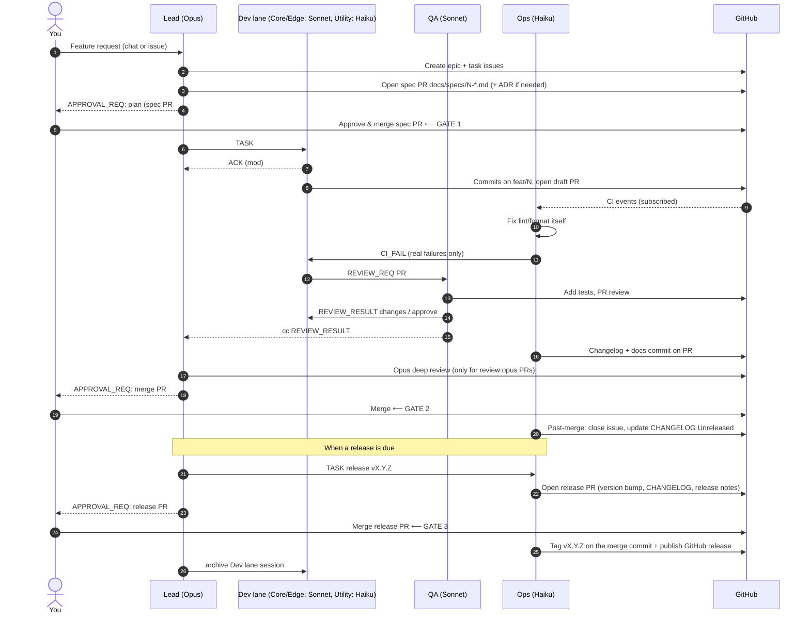

# Multi-Session Claude SDLC — Design

**Status:** Draft v1 · **Runtime:** Claude Code cloud sessions · **Shared state:** GitHub
**Human gates:** you approve every plan, every merge and every release

This document describes a software development lifecycle (SDLC) in which a small team
of Claude Code cloud sessions works together like a dev team. Each session has its own
role and model, and they coordinate through **DevBus**, a mod built on Claude's native
session bus. GitHub stays the single source of truth for every artifact.

---

## 1. Design goals

| Goal | How it is met |
|---|---|
| **Token efficiency** | Messages carry *pointers* (issue #, PR #, SHA, file path), never pasted content. The mod handles acks and heartbeats without waking the model. Each role gets the cheapest model that does the job well. Short-lived worker sessions keep contexts small. |
| **Quality** | Opus plans and makes the architecture calls. Every PR gets a separate test-and-review pass. Escalation path: Haiku → Sonnet → Opus. |
| **Human control** | Three hard gates (plan approval, merge and release). Agents can never merge or push to `main`; the mod blocks those calls. |
| **Traceability** | Every task is a GitHub issue, every plan is a spec PR, every change is a PR, every decision is an ADR. Bus messages always cite those IDs. |
| **Resilience** | Sessions are stateless apart from what is in GitHub, so any session can be archived and recreated from the roster and the issue history. |

---

## 2. Team topology: 3 standing sessions + 3 lane-based dev sessions

You named five responsibilities: architect, developer, tester, scribe and CI/CD. They
are packed into **three standing sessions** (Lead, QA, Ops) plus **three dev sessions,
one per lane**, pairing roles that share context and cost profile:

| # | Session | Roles | Model | Why this model |
|---|---|---|---|---|
| 1 | **Lead** | Architect / design lead, orchestrator, your single point of contact | **Opus 5.5** (`claude-opus-5-5`) | Few but high-impact calls: decomposition, interfaces, trade-offs, design review. Mostly reads, writes little, so Opus pricing is spent where it matters. |
| 2 | **Dev lanes** (Core, Edge, Utility, see §2.1) | Developer / coder | **Sonnet 5.5** (`claude-sonnet-5-5`) for Core and Edge, **Haiku 5.5** for Utility | The highest-volume token users. Sonnet gives near-Opus coding quality at a fraction of the cost, and Haiku handles the small tickets. All use Haiku subagents for codebase search. |
| 3 | **QA** | Tester and code reviewer | **Sonnet 5.5** | Writing tests and reviewing code needs real reasoning. Uses a separate context from Dev, so its review is independent. |
| 4 | **Ops** | CI/CD and scribe (docs, changelog, release notes) | **Haiku 5.5** (`claude-haiku-5-5`) | Mostly mechanical work: watching CI, reading logs, applying lint/format fixes, writing changelogs and README updates. Escalates anything non-trivial. |

Why not five sessions? Pairing **scribe + CI/CD** works because both trigger on the
same event ("a PR changed") and both are low-reasoning. Pairing **tester + reviewer**
gives one independent "second pair of eyes" with fresh context. A separate scribe
session would mostly sit idle and re-read the same PRs, which wastes tokens.

### 2.1 Dev lanes

The three dev sessions each own a **lane**: a set of folders and a kind of work. Each
lane is started only when it has work and closed after its PR merges, so at most one
session runs per lane (`maxDevs: 3`).

| Session | Owns | Typical work | Model |
|---|---|---|---|
| **Dev-Core** (backend) | API routes, business logic, data models, database migrations, auth | Flask/FastAPI endpoints, services, storage | Sonnet 5.5 |
| **Dev-Edge** (interface and integrations) | Frontend or templates, CLI interfaces, clients for outside APIs, config files | UI pages, CLIs, third-party API calls, wiring parts together | Sonnet 5.5 |
| **Dev-Utility** (small and mechanical) | Issues labelled `size:S` in any area, standalone scripts | Small bug fixes, dependency bumps, renames and refactors, one-off automation scripts | Haiku 5.5, hands off after 1 failed attempt |

**Why lanes:**
- **Fewer merge conflicts.** Each lane owns its own folders, so parallel devs rarely touch the same files.
- **Lower cost.** Small tickets go to Haiku instead of Sonnet. QA still reviews every PR.
- **Steadier context.** A lane-specific prompt stays the same on every spawn, so it is cached.

**How the Lead assigns work:**
1. `size:S` → **Dev-Utility**, whatever the area.
2. Otherwise route by the folders the change touches: backend → **Dev-Core**; UI, CLI or integrations → **Dev-Edge**.
3. A change that crosses lanes is split in the spec into one issue per lane, with the shared
   interface (API contract or schema) defined first. Core builds its side first, then Edge
   builds against it.
4. Lane folder ownership for each project is declared in the spec, under "Lane ownership".
   The DevBus mod warns when a dev edits outside its lane.

**Hand-off from Utility.** If Dev-Utility can't finish a `size:S` issue in 1 attempt, it
sends `ESCALATE` to the Lead. The Lead relabels the issue (`size:M`) and reassigns it to Core or Edge.

### Escalation path (model routing)

```
Haiku (Ops / Dev-Utility) ──can't fix in 1 attempt──▶ Sonnet (Dev-Core / Dev-Edge) ──2 failed attempts / design question──▶ Opus (Lead) ──needs product decision──▶ You
```

- Ops fixes lint, format, lockfile and flaky-retry issues on its own. A real test failure
  goes to the PR's Dev.
- Dev escalates to the Lead after 2 failed attempts at one problem, or on any question
  about an interface or schema.
- **Opus deep review** (the Lead reviews, after QA approves) is required for PRs that are
  large (`size:L`, or more than 400 changed lines) **and** either a
  **major infrastructure change** (CI/CD workflows, deployment or infrastructure-as-code,
  Dockerfiles, database schema or migrations, new services, major-version dependency upgrades)
  or a **major feature** (issue labelled `feature:major`: a new user-facing capability, an epic
  spanning lanes, or a new public API). Such PRs are labelled `review:opus`.
  The Lead marks expected cases at spec time; QA applies the label when it sees a PR matches.
  All other PRs get QA's Sonnet review only.

---

## 3. Architecture


### 3.1 Communication layers

| Layer | Mechanism | Used for |
|---|---|---|
| Session spawn and lifecycle | `create_session` (with `model`, `append_system_prompt`, `source_url`, `outcome_branch`), `archive_session` | The Lead creates and retires workers |
| Messaging | Native session bus: `send_message` / `$.session.send`, delivered as `session.receive` | All coordination between agents |
| DevBus mod | Hooks on `session.send`, `session.receive`, `tool.call`, plus registered tools, commands and a pane | Envelope format, routing by role, guardrails, token saving, team board |
| Durable state | GitHub issues, PRs, labels, `docs/` | Everything that must outlive a session |
| External events | `subscribe_pr_activity` (CI, reviews, comments) | Ops and Devs react to CI and review comments |
| Scheduling | `send_later` / scheduled tasks | Lead's daily stand-up digest, stale-task sweeps |

---

## 4. DevBus mod: design

DevBus is a Claude Code **mod** (hooks module plus manifest) installed in every session.
It does not replace the native bus. It wraps it, adding structure and enforcement.

### 4.1 What it hooks

| Hook / API | Behaviour |
|---|---|
| `session.start` | Reads its role from the `DEVBUS_ROLE` env var, or from the first `ROSTER` message. Registers the bus tools and slash commands, opens the Team Board pane and starts a heartbeat timer (`$.clock.every`). |
| `$.tool.register` → `mcp__devbus__bus_send` | The only way the model sends a bus message. Takes structured fields (`to`, `type`, `refs`, `summary`), builds the envelope and calls `$.session.send({ to: { sessionId } })` after resolving role → sessionId from the roster. Registered with `isDeferred: false` so the model always sees it. |
| `mcp__devbus__bus_roster`, `bus_board` | Read-only views of the roster and open tasks, so the model never has to "ask around". |
| `session.send` | Rejects free-form or oversized messages: no valid envelope, or `summary` over 600 chars, gives `isDelivered:false`. This forces pointers instead of pasted code. Also scrubs anything that looks like a secret. |
| `session.receive` | Parses incoming envelopes and updates the Team Board state. **Consumes** (`{ consumed }`) `HEARTBEAT`, duplicate (same `id`) and pure `ACK` messages, so they never cost a model turn. Messages that need work are rewritten to a short normalized form before the model reads them. |
| `tool.call` guards | Blocks `merge_pull_request`, `enable_pr_auto_merge`, any push to `main`/`master`, and `--force` pushes for **every** role. Blocks `git tag` and release creation unless the target is the merge commit of a merged `release/*` PR. Per role: Ops may only write under `docs/`, `CHANGELOG.md`, `.github/` and lint fixes. QA may not edit `src/` except test files. Only the Lead may call `create_session` / `archive_session`. |
| `session.measure` | Watches context and rate-limit usage. Past 70% context it shows a toast suggesting `/compact`. Past the per-session budget it sends `BUDGET` to the Lead. |
| `ui` | **Team Board pane**: roster, each session's current task, status, last heartbeat, and pending approvals. **Status line**: `role · #issue · state`. **Toast** on `BLOCKED` or `APPROVAL_REQUEST`. |
| Commands | `/bus` (board), `/handoff <role> <#ref>`, `/blocked <reason>`, `/roster`, `/approve <#pr>` (Lead only, which relays your approval). |

**Roster distribution.** `$.store` is per container, so it is **not** shared across
cloud sessions. The Lead owns the roster (`role → sessionId`). It broadcasts a `ROSTER`
envelope to every session on spawn and on every change, and each session keeps it in
`$.state`. A copy is also kept in a pinned GitHub issue, "DevBus roster", so a recreated
Lead can recover it.

**Distribution of the mod.** The mod lives in this repo under `tools/devbus/`, with a
`.claude-plugin/marketplace.json`, so every cloud session that clones the repo can
install it. The Lead's spawn prompt tells each worker to install it as its first step.

### 4.2 Envelope format (DevBus v1)

One line of header, then at most 600 chars of summary. Pointers only.

```
[DEVBUS/1] id=<ulid> type=<TYPE> from=<role> to=<role|*> task=#<issue> pr=#<pr|-> sha=<short|-> reply=<id|->
<summary: what / what you need — no pasted code or logs>
```

| Type | Sender → Receiver | Meaning | Model turn? |
|---|---|---|---|
| `ROSTER` | Lead → * | Current role → session map | No (mod stores it) |
| `TASK` | Lead → Dev/QA/Ops | Do issue #N. Spec at `docs/specs/N-*.md`, branch `feat/N-slug` | Yes |
| `ACK` | any → sender | Received / started | No |
| `STATUS` | worker → Lead | Progress milestone | Batched (see 5.3) |
| `BLOCKED` | any → Lead | Needs a decision; summary gives options A/B | Yes |
| `REVIEW_REQ` | Dev → QA | PR #M ready for test and review | Yes |
| `REVIEW_RESULT` | QA → Dev, cc Lead | `approve` or `changes` (details in PR review comments) | Yes |
| `CI_FAIL` | Ops → Dev | CI failed on PR #M. Job and log line refs only | Yes |
| `ESCALATE` | any → next tier | Can't solve, see path in §2 | Yes |
| `APPROVAL_REQ` | Lead → You (via chat + PR) | Spec PR, code PR or release PR ready for your gate | — |
| `DONE` | worker → Lead | Task finished, PR merged | Yes (Lead) |
| `HEARTBEAT` | any → Lead | Alive + current task | No |
| `BUDGET` | mod → Lead | Session hit its token budget | Yes |

---

## 5. Lifecycle: one feature, end to end



### 5.1 Phases and owners

| Phase | Owner | Output (in GitHub) | Gate |
|---|---|---|---|
| 1. Intake | Lead | Epic issue + task issues with acceptance criteria | — |
| 2. Design | Lead | Spec PR: `docs/specs/<n>-<slug>.md` (interfaces, data model, test plan, task split), optional `docs/adr/NNNN-*.md` | **You approve and merge the spec PR** |
| 3. Build | Dev(s) | Feature branch + draft PR referencing the issue | — |
| 4. CI | Ops | Green checks. Trivial fixes committed by Ops | — |
| 5. Test & review | QA | Test commits + PR review (approve or changes) | QA approval required |
| 6. Docs | Ops (scribe) | `CHANGELOG.md`, README/docs updates on the same PR | — |
| 7. Merge | **You** | Merged PR | **You merge** |
| 8. Release | Lead decides when; Ops prepares | Release PR `release/vX.Y.Z` (version bump, `CHANGELOG.md`, release notes). After merge: tag + GitHub release | **You approve and merge the release PR** |

### 5.2 How you approve

- **Plan approval = merging the spec PR.** It's reviewable, diffable and leaves an
  audit trail. Comment on the spec PR to request changes, and the Lead (subscribed to
  it) revises.
- **Merge approval = you clicking Merge** on the code PR. Agents are blocked from
  merging by the mod and by branch protection.
- **Release approval = merging the release PR.** Ops tags and publishes only after you
  merge it. The DevBus mod blocks tagging and release creation on any commit that is not
  the merge commit of an approved `release/*` PR.
- You can always talk to the Lead directly in the Claude app ("pause Dev-Edge", "re-plan #14").

### 5.3 Token-saving rules (enforced by the mod or role prompts)

1. **Pointers, not payloads.** Messages cite `#issue`, `#pr`, SHAs and file paths. The receiver pulls only what it needs from GitHub.
2. **Mod-handled traffic.** `ACK`, `HEARTBEAT`, `ROSTER` and duplicates are consumed by the mod and never reach the model.
3. **Batched status.** Workers send `STATUS` only at milestones (PR opened, ready for review, done), not per commit.
4. **Fresh contexts per task.** Dev lane sessions are created when their lane has work and archived after merge. Standing sessions `/compact` with "keep: roster, open tasks" between features.
5. **Stable prompts = cache hits.** Role prompts are passed once via `append_system_prompt` and never edited mid-session, so the prompt prefix stays cacheable.
6. **Cheap exploration.** Dev and QA use Haiku `Explore` subagents for codebase search and keep only the conclusions.
7. **Lead reads diffs sparingly.** It reviews specs and `review:opus` PRs only. QA covers the rest.
8. **CI logs.** Ops passes job name + failing test + log line range, never full logs.

### 5.4 Expected token split (rough guide)

| Session | Share of tokens | Share of cost |
|---|---|---|
| Dev-Core + Dev-Edge, Sonnet | ~45% | ~40% |
| Dev-Utility, Haiku | ~10% | ~3% |
| QA, Sonnet | ~20% | ~17% |
| Lead, Opus | ~10% | ~30% |
| Ops, Haiku | ~15% | ~10% |

Compared with running every role on Opus, this should cut cost substantially, while
the work that most affects quality (design and hard reviews) stays on Opus.

---

## 6. GitHub conventions

| Item | Convention |
|---|---|
| Labels | `lane:core` `lane:edge` `lane:utility` · `size:S` `size:M` `size:L` · `role:qa` `role:ops` · `state:planned` `state:in-progress` `state:review` `state:blocked` · `review:opus` `feature:major` `infra:major` · `release` · `needs-approval` |
| Branches | `spec/<n>-<slug>` (Lead), `feat/<n>-<slug>` / `fix/<n>-<slug>` (Dev) |
| PR body | `Closes #n`, spec link, test plan, size and any `review:opus` / `infra:major` / `feature:major` labels |
| Branch protection on `main` | 1 human approval, required CI checks, no force push |
| Docs | `docs/specs/`, `docs/adr/`, `CHANGELOG.md` (Keep a Changelog) |
| Roster | Pinned issue "DevBus roster" (Lead updates it) |

---

## 7. Bootstrapping

1. Add branch protection on `main` (one human approval + CI).
2. Start the **Lead** session in the Claude app on this repo with model **Opus 5.5**,
   and paste `docs/sdlc/roles/lead.md` as the first message (or set it as the session's
   appended system prompt).
3. The Lead reads `docs/sdlc/sdlc.config.json` and spawns QA and Ops (and each dev lane when it
   first gets an approved task) with `create_session`, passing each worker's model and its role file
   as `append_system_prompt`, then broadcasts `ROSTER`.
4. The Lead subscribes Ops to open PRs (`subscribe_pr_activity`) as PRs are created.
5. A daily scheduled task wakes the Lead to post a stand-up digest on the roster issue
   and to sweep stale `state:in-progress` issues.

---

## 8. Failure handling

| Failure | Detection | Response |
|---|---|---|
| Worker silent | Missing 3 heartbeats (Team Board shows stale) | Lead calls `get_session`. If failed, archives it, recreates it with the same role and re-sends `TASK` from issue state |
| Agents disagree (QA vs Dev) | 2 rounds of `changes` on one PR | Auto-escalate to Lead. Lead decides or asks you |
| CI red repeatedly | Ops can't fix in 1 attempt | `CI_FAIL` to Dev. After 2 Dev attempts, `ESCALATE` to Lead |
| Budget exceeded | `session.measure` in mod | `BUDGET` → Lead pauses the session or moves the task to a fresh one |
| Lead lost | You notice / board empty | Start a new Lead. It rebuilds the roster from the pinned issue and `list_sessions` |

---

## 9. Open decisions (for you)

1. **Dev concurrency cap.** Decided: 3, one session per lane (Core, Edge, Utility).
2. **Release gate.** Decided: every release needs your approval (merge of the release PR).
3. **Opus deep-review scope.** Decided: large PRs that are major infrastructure changes or
   major features (see §2).
4. **Build the DevBus mod next?** This document is the design. Next steps would be building
   `tools/devbus/` (mod + tests) and a sample feature run on `flaskapi/`.

---

Files in this design:

- `docs/sdlc/DESIGN.md`: this document
- `docs/sdlc/sdlc.config.json`: roles, models, budgets, guardrails (machine-readable)
- `docs/sdlc/roles/lead.md`, `dev-core.md`, `dev-edge.md`, `dev-utility.md`, `qa.md`, `ops.md`: role prompts
- `docs/sdlc/protocol.md`: DevBus envelope quick reference for agents
